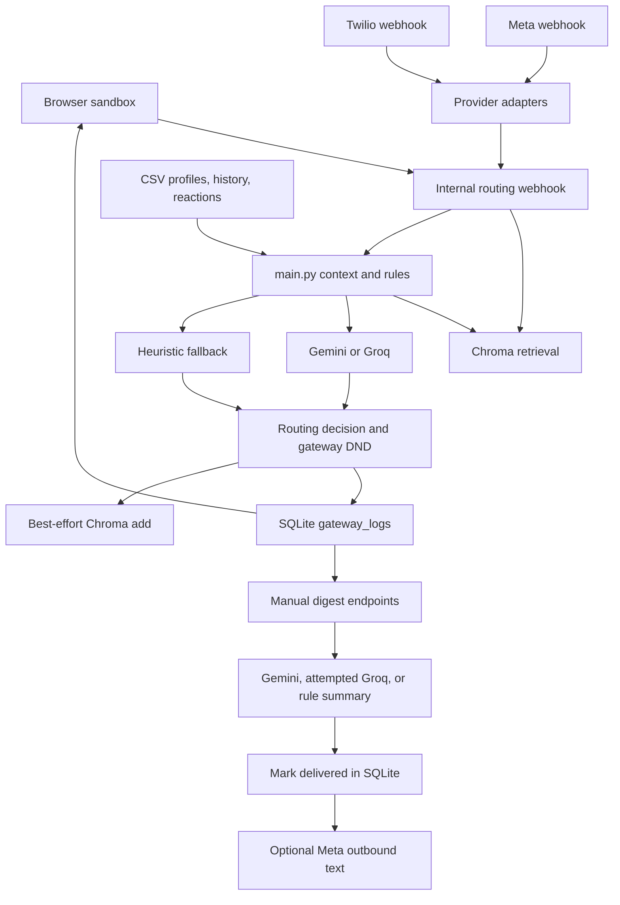

# Message Router status

**10 November 2026 implementation update:** B02 is complete: configured dataset/storage paths, safe deterministic demo bootstrap, CSV validation, offline operation, and authenticated setup status. See [DATASET_WORKFLOW.md](DATASET_WORKFLOW.md) for usage, tests, and scope. The original audit snapshot below is historical; the 9 November repairs are documented in [REPAIR_RESULTS.md](REPAIR_RESULTS.md).

**9 November 2026 repair update:** the verified cold-start, ownership, policy, authentication, digest, replay, and Groq failures now have targeted repairs and regression tests. See [REPAIR_RESULTS.md](REPAIR_RESULTS.md) for exact changed files, observed checks, necessary interface changes, and remaining limits. The audit below is the historical 7 November snapshot, not a claim that every listed failure is still present.

Audit date: 7 November 2026 (Asia/Calcutta). Scope: the entire first-party working tree at `C:\Users\harsh\Harshit\message_router\msg_router`, plus the adjacent `..\README.md` that describes this project. Git HEAD: `16c41b8857629f838829ad05c63e7fcf2f62349c` (`fixed docker file`).

**Assessment: an implemented notification-routing prototype with substantial integration and correctness gaps. The current evidence does not support the adjacent README's production-readiness claim.** The heuristic path and developer console have useful foundations, but batch routing is broken, prompt construction can fail, user isolation is not maintained throughout retrieval, and delivery is incomplete.

This is an inspection report, not an implementation change. `server.py` and `tests/test_router.py` already had uncommitted changes when inspection began (600 additions and 4 deletions combined). Those changes are included in this assessment; they introduce the Meta/Twilio adapters and digest lifecycle, among other edits. They were not made by this audit. The adjacent README is outside this Git repository and is not included in its tracked contents.

Related deliverables:

- [Missing-features matrix](MISSING_FEATURES.md): implemented, partial, broken, and absent capabilities.
- [Prioritized completion backlog](COMPLETION_BACKLOG.md): ordered work, dependencies, and acceptance criteria. No backlog item has been implemented by this audit.

## 1. Intended function and actual boundary

The intended product sits between messaging streams and a recipient's notifications. It combines conversation context, past reactions, sender/group/business metadata, quiet hours, and optionally an LLM to return:

| Action | Intended meaning | Actual implementation |
| --- | --- | --- |
| `notify` | Immediate attention/delivery | A classification, SQLite log, and simulated inbox entry. There is no action-specific push/delivery worker. |
| `digest` | Defer useful updates into a summary | SQLite rows serve as a pending queue; manually invoked endpoints summarize and mark rows delivered. Optional outbound Meta text exists. No scheduler exists. |
| `mute` | Suppress spam, scams, or unwanted traffic | A classification, log, and simulated quarantine entry. No upstream WhatsApp suppression API is called. |

This intent is explicit in `../README.md:9–64`, the routing prompt at `main.py:483–520`, and the console labels in `static/index.html:146–178`. The implementation also retains an older CSV challenge/submission workflow (`main.py:630–719`, `generate_data.py`, `evaluate.py`, `pack.py`).

The Meta adapter receives messages sent to a WhatsApp business endpoint and responds to their sender if auto-reply is enabled. Both live adapters currently treat the incoming sender's phone number as the router's `user_id`, classify the conversation as `business`, and use a fixed gateway business ID (`server.py:458–468`, `495–505`). They do not map an authenticated recipient account or reproduce the full personal/group/business model supported by the internal webhook. There is no implementation that intercepts all notifications on a user's device.

## 2. Repository inventory and architecture

All 16 tracked files were inspected, including the complete Python, HTML, JavaScript, CSS, dependency list, Dockerfile, and ignore file. Generated/runtime material was inspected by metadata or read-only aggregate queries rather than by executing it or exposing message contents. No `AGENTS.md` was found in the repository or applicable ancestor directories.

| File/component | Responsibility and coupling |
| --- | --- |
| `server.py` (1,070 lines) | FastAPI app, module-level initialization, mutable global configuration, SQLite ORM, routing orchestration, provider webhooks, digest processing, dashboard/query/media endpoints, static hosting. |
| `main.py` (719 lines) | CSV-backed profiles and lazy transaction tables; DND/text helpers; heuristic engine; RAG prompt builder; Gemini/Groq calls; batch CSV prediction entry point. |
| `vector_store.py` | Persistent Chroma client; CSV history/event join and batch indexing; four-stage contextual retrieval; manual self-test. |
| `static/index.html`, `static/app.js`, `static/style.css` | Vanilla browser sandbox, model/threshold/DND controls, recent audit traces, mock recipient channels, prompt/RAG inspector, responsive styling. No frontend package/build pipeline. |
| `tests/test_router.py` | 16 tests; API smoke tests, three heuristic cases, corpus-dependent RAG check, provider webhook parsing, digest lifecycle. Imports the application and mutates its normal storage by default. |
| `generate_data.py` | Seeded synthetic users/groups/businesses, 10,000 history rows, 1,000 target messages, simulated reactions, labels, and output template. Top-level execution writes to a legacy sibling path. |
| `expand_datasets.py` | Optional Hugging Face DailyDialog plus 500 synthetic business updates; appends CSVs and force-rebuilds Chroma. |
| `ingest_telemetry.py` | Downloads UCI SMS Spam Collection, assigns synthetic identities/reactions, appends CSVs, cleans downloads, force-rebuilds Chroma. |
| `ingest_real_telemetry.py` | Downloads DailyDialog and Google Schema-Guided Dialogue text; maps it to synthetic identities/reactions; appends and rebuilds. These are not observed user engagement logs. |
| `evaluate.py` | Heuristic-only action/type accuracy against legacy sibling CSVs. No committed evaluation fixture or results artifact. |
| `pack.py` | Top-level legacy submission ZIP/output/transcript packaging; assumes sibling challenge directories and a developer-specific absolute transcript path. Omits required router code from its ZIP. |
| `requirements.txt`, `Dockerfile`, `.gitignore` | Unpinned Python dependencies, Python 3.11 container, port 8000, ignored local environments/secrets/databases. No lockfile, `.dockerignore`, CI workflow, or project packaging metadata. |

There is one process-local application, not separate routing, queue, worker, and delivery services. SQLAlchemy, pandas, Chroma, Gemini, and synchronous Requests operations run directly inside async endpoint bodies. There is no job broker or background scheduler.

## 3. Entry points and API surface

These are code-defined entry points, not commands executed against the live working tree during this audit.

| Entry point | Behavior / caveat |
| --- | --- |
| `python server.py` | Starts Uvicorn on `127.0.0.1:8000` (`server.py:1067`). |
| `python -m uvicorn server:app --host 0.0.0.0 --port 8000` | Container command, with `/app` as working directory (`Dockerfile`). |
| `python -m uvicorn msg_router.server:app ...` | Adjacent README's parent-directory invocation; source adds its own directory to `sys.path` for absolute imports. |
| `python main.py` | Batch classifier; currently fails on unloaded `messages` before producing predictions. Would overwrite `dataset/output.csv`. |
| `python vector_store.py` | Indexes `dataset/message_history.csv` if present, then queries Chroma. Can write storage and fetch embedding assets. |
| `python generate_data.py`, ingestion/expansion scripts | Write datasets or rebuild persistent indexes; not safe read-only diagnostics. |
| `python evaluate.py` | Reads missing legacy inputs and calls heuristic retrieval, which can create/open Chroma. Not run in place. |
| `python pack.py` | Creates archives and copies output/transcript files at import/execution time. Not run. |

The application defines 18 HTTP operations plus the static mount and FastAPI's generated documentation/schema routes:

| Method and path | Purpose / effect | Evidence |
| --- | --- | --- |
| GET, POST `/api/gateway/config` | Read/change global model, L2 threshold, DND flag; no persistence or authentication | `server.py:133–158` |
| POST `/api/gateway/webhook` | Internal dictionary payload -> decision, log insert, vector add | `server.py:161–349` |
| GET `/api/gateway/logs?limit=50` | Global recent traces including message text, compiled prompts, and retrieved content | `server.py:737–767` |
| GET `/api/webhook/whatsapp` | Meta verification-token challenge | `server.py:385–397` |
| POST `/api/webhook/whatsapp` | Parse text, caption, audio, document, interactive events; skip status-only events; optional auto-reply | `server.py:400–482` |
| POST `/api/webhook/twilio-whatsapp` | Parse URL-encoded text payload, route, return empty TwiML | `server.py:485–509` |
| GET `/api/digest/pending/{user_id}` | Read pending digest rows | `server.py:668–698` |
| POST `/api/digest/generate/{user_id}?auto_send=false` | Summarize and consume pending rows; optionally send | `server.py:598–665`, `701–705` |
| POST `/api/digest/dispatch-all?auto_send=false` | Sequentially process every user with pending rows | `server.py:708–734` |
| GET `/api/users` | CSV-backed recipient profiles; returns empty list if dataset absent | `server.py:773–776` |
| GET `/api/contacts/{user_id}` | CSV history/target-derived contacts; inserts a sandbox contact fallback | `server.py:779–848` |
| GET `/api/client/messages/{user_id}/{contact_id}` | Combine CSV history/events with gateway logs; currently references undefined globals | `server.py:851–967` |
| GET `/api/client/device/{user_id}` | Split all user's logs into inbox/digest/quarantine, sorted by message ID | `server.py:970–1008` |
| GET `/api/incoming/{user_id}` | CSV target messages; does not consume queue entries | `server.py:1011–1016` |
| GET `/api/media/image/{media_id}`, `/api/media/voice/{media_id}` | Resolve local media manifests/files; no provider media download | `server.py:1022–1053` |
| GET `/` | Redirect to `/static/index.html` | `server.py:1057–1065` |

## 4. Routing rules and precedence

### Heuristic engine

`main.py:97–428` implements the following sequence:

1. Resolve the user's CSV profile and DND window, normalize text, then immediately mute certain injection phrases (`ignore` + `rules`, `system note`, `assistant instruction`, `routing override`).
2. Detect scam substrings, including OTP/login-code phrases, wallet/payout verification, processing fees, and the bare word `leak`. A 3–8 digit sequence plus a verified business or group-admin sender can exempt an OTP from the scam action. Some other scam-keyword matches are also exempted for verified/admin senders.
3. Calculate mention, group-mute, and promotion-opt-out flags.
4. Retrieve up to five Chroma matches. If none, compare local history in the same user/thread by media identity or normalized word overlap above 0.4. Chroma similarity is converted using `max(0, 1-distance/2)`; no configured distance cutoff is applied here.
5. Across matches, reported/muted reactions take precedence, then dismissed, replied, opened; map to mute/mute/notify/digest. A single matching reaction can determine the action; the wording about repeated behavior is stronger than the actual check.
6. Without matches, use the first unsorted local thread row (called “most recent” in code). A replied-to thread notifies only when the new text contains broad urgency keywords; otherwise digest. Unknown senders/threads default to digest, including new urgent messages.
7. Apply final overrides: scam -> mute; mention -> notify; muted group -> digest; business opt-out -> mute. The business opt-out check applies to every message in that business context, including transactional messages.
8. Convert notify to digest during DND unless mentioned. This executes inside the heuristic regardless of the gateway's DND enable flag.
9. Independently classify message type by ordered substring checks, forwarded count, conversation type, group type, or business category. The declared taxonomy is `personal`, `urgent`, `event`, `payment`, `business_update`, `promotion`, `greeting`, `forward`, `spam`, `scam`, `unknown`; there is no explicit heuristic branch producing `spam`.

Confirmed rule inconsistencies include mention normalization, valid OTPs still receiving type `scam`, and an ordinary water-leak alert being muted as a scam. See the diagnostic evidence and backlog.

### LLM engine and gateway policy

Initial engine selection is Gemini if its key exists, else Groq if its key exists, else heuristic (`server.py:108–117`). Gemini initialization failure can leave the configured name as Gemini while routing actually falls through to heuristics.

The gateway first retrieves matches and filters them for its trace response using `CONFIG['l2_distance_threshold']`. It then independently compiles a prompt, and the selected engine retrieves again. Gemini compiles another prompt internally. Thus one request can retrieve three times. The filtered trace is not the context consumed by the classifier (`server.py:201–260`, `main.py:167–179`, `436–448`, `569–570`).

Gemini sends JSON-mode content and optional locally resolved image/voice files. On failures inside its generation block it tries Groq, then heuristics (`main.py:569–628`). Its prompt compilation occurs before that block, so prompt errors skip that provider fallback and reach the gateway's heuristic fallback. Groq uses a synchronous Requests POST and returns `None` on failure (`main.py:525–566`). The gateway catches an unpacking/provider error and tries heuristics.

The scam/injection/group/opt-out rules are **not** a deterministic precondition or postcondition on an LLM decision. They appear as prompt instructions or run only if heuristics execute. The prompt itself does not supply group mute, sender-admin, verified-business, or promotion-consent records. The gateway independently applies DND after the engine (`server.py:261–280`); highly urgent messages have no special exemption there. LLM JSON is parsed but action/type enums, evidence ownership, confidence bounds, and field types are not validated. Model-used tracing can misattribute a Gemini-internal fallback.

## 5. Data flow and persistence

**On module import:** `.env` is loaded; profile CSVs are read; transaction tables are assigned `None`; SQLite tables are created; an `ALTER TABLE` is attempted with all exceptions suppressed; an optional Gemini client is initialized; the static directory is ensured. Importing `server.py` therefore is not a read-only operation (`main.py:11–60`, `server.py:22–129`, `1062–1065`).

**On routing:** minimum field truthiness check -> pandas Series with server-local current timestamp -> RAG -> attempted prompt -> selected engine/fallback -> gateway DND -> SQLite commit -> best-effort Chroma add -> JSON response (`server.py:161–344`). Client/provider event timestamps are ignored. The latency timer ends before SQLite persistence and vector indexing, so logged latency is not total endpoint latency. Failures after a SQLite commit cannot roll it back if vector insertion fails.

**On retrieval:** strict user+channel -> user only -> channel only -> global. The last two stages remove the user filter. Conversation type and event time are not explicit constraints. The first nonempty stage wins, even if its matches are distant (`vector_store.py:102–178`). Live text is indexed by `message_id` alone, without reaction metadata, media ID, or timestamps (`server.py:312–334`). There is no feedback-write endpoint; later opens/replies/reports are not learned automatically.

**On digest generation:** select all pending digest rows for a user in ID order -> create summary -> mark every selected row delivered and commit -> optionally call Meta outbound -> return the summary (`server.py:598–665`). Generating without sending consumes the queue. Failed/skipped sending also leaves it consumed. No digest artifact, retry/outbox record, lease, schedule, size limit, or delivery receipt is persisted. Concurrent generators can select the same pending rows. The fallback summary's “Latest” preview uses the first/oldest selected row.

### Data contracts and observed local state

| Store/input | Expected data or observed state |
| --- | --- |
| `dataset/users.csv` | User ID/name, DND string, 30-day engagement counts. Dataset directory is absent. |
| `groups.csv`, `group_members.csv` | Group metadata; per-member role and mute flag. Absent. |
| `business_accounts.csv`, `user_business_history.csv` | Business category/verification; per-user promotion consent. Absent. |
| `messages.csv`, `message_history.csv` | ID, user, personal/group/business type, sender/group/business IDs, created-at, text, media type/ID, forwarded count. Absent. |
| `message_events.csv` | `(message_id, user_id)` reactions: opened, replied, dismissed, muted-after, reported. Absent. |
| `images.csv`, `voice_notes.csv`, `dataset/media/...` | Media-ID/file manifests and local files. Absent. |
| `dataset/output.csv` | Both the batch output and pre-existing template defining output row order; absent. |
| Legacy `../hackerrank-orchestrate-august26/dataset{,_large}` | Generator/evaluator/packaging paths; both dataset locations are absent. |
| `msg_router_gateway.db` | 20,480-byte ignored SQLite file, `gateway_logs` table, 12 rows: 8 digest, 4 mute, no notify. Eight delivered flags and four undelivered flags; the four undelivered rows are mute, so pending digest count is zero. |
| Stored trace aggregates | 6 of 12 `prompt_compiled` fields begin `Prompt compilation failed:`. Timestamps range from 20 September to 18 October 2026 (stored naive values; not converted to a user timezone). |
| `chroma_db/chroma.sqlite3` | 29,515,776 bytes; one `message_history` collection; 16,588 rows in Chroma's embeddings table, two segment rows. These are storage counts, not proof that semantic retrieval is healthy or accurate. |

The existing gateway schema has `digest_delivered`, but its index list lacks the ORM-declared digest-delivered index. The manual migration adds only a column and swallows all failures (`server.py:90–105`). Neither database was opened through the application/Chroma client against the working tree during diagnostics. SQLite queries used `mode=ro` and `PRAGMA query_only=ON`; no message bodies were printed.

## 6. Dependencies and external integrations

`requirements.txt` lists 12 unpinned distributions. Observed installed versions in the existing `.venv`:

| Dependency | Installed | Usage |
| --- | --- | --- |
| pandas / NumPy | 3.0.5 / 2.5.1 | CSVs, dataframes, missing-value handling |
| pillow | 12.3.0 | Declared; no direct first-party import found |
| google-genai | 2.16.0 | Gemini generation and file upload/delete |
| python-dotenv | 1.2.2 | Automatic environment-file loading |
| chromadb | 1.5.9 | Persistent vectors and default embedding behavior |
| tqdm | 4.70.0 | Indexing progress |
| requests | 2.34.2 | Groq HTTP calls |
| fastapi / uvicorn | 0.141.1 / 0.52.1 | HTTP application and server |
| sqlalchemy | 2.0.51 | SQLite ORM |
| datasets | 5.0.1 | Optional DailyDialog import |

Additional installed runtime/test dependencies include HTTPX 0.28.1, pytest 9.1.1, Starlette 1.3.1, Pydantic 2.13.4, and ONNX Runtime 1.28.0. `server.py` directly imports HTTPX but it is not explicitly declared in requirements; Docker installs it separately alongside pytest. It is also available transitively in this environment. Metadata checks found the declared direct dependencies' active requirements satisfied. This is not a fresh-install or complete transitive compatibility guarantee.

Local Python is 3.14.5, while Docker uses `python:3.11-slim`; compatibility parity is unverified. No dependencies were installed or updated.

| External integration | Code-defined contract | Audit boundary |
| --- | --- | --- |
| Gemini | `google.genai.Client`; model defaults to `gemini-2.5-flash`; JSON routing, text summaries, local image/voice upload/delete | No credential validation or provider calls |
| Groq | `https://api.groq.com/openai/v1/chat/completions`; bearer auth; `llama-3.3-70b-versatile`; 15s Requests timeout | Routing client exists; digest instead imports nonexistent `main.groq_client` |
| Meta WhatsApp | `https://graph.facebook.com/v20.0/{phone_id}/messages`; text sends with 10s HTTPX timeout; GET verification and POST inbound | API version/credentials/provider behavior not checked online; outbound HTTP error status is not checked |
| Twilio WhatsApp | URL-encoded inbound `From`, `Body`, `MessageSid`; empty TwiML response | No signature validation, media handling, or outbound Twilio client |
| Chroma default embeddings | No explicit embedding function/model/configuration is supplied by first-party code | Real query/add can initialize storage or need downloadable embedding assets; existing semantic index not exercised |
| Hugging Face DailyDialog | `load_dataset('daily_dialog', ..., trust_remote_code=True)` | Script inspected only; current compatibility with installed datasets version is unverified |
| UCI SMS / DailyDialog ZIP / Google SGD JSON | URLs embedded in ingestion scripts; DailyDialog ZIP uses plain HTTP | No downloads or endpoint checks; no availability, license, checksum, or provenance validation |

## 7. Configuration and deployment

| Setting | Default / behavior |
| --- | --- |
| `GEMINI_API_KEY`, `GROQ_API_KEY` | Optional; influence initial routing engine and digest provider selection. Both key names occur in the local ignored `.env`; values were not disclosed or used. Presence does not establish validity. |
| `GEMINI_MODEL` | `gemini-2.5-flash`; local `.env` contains this setting name. |
| `GROQ_MODEL` | `llama-3.3-70b-versatile`; local `.env` contains this setting name. Routing rereads environment; digest reads global CONFIG. |
| `WHATSAPP_VERIFY_TOKEN` | Falls back to the public literal `my_whatsapp_verify_token`. |
| `WHATSAPP_TOKEN`, `WHATSAPP_PHONE_NUMBER_ID` | Missing values cause outbound sends to return `skipped`. |
| `WHATSAPP_AUTO_REPLY` | String `false`; only case-insensitive `true` enables inbound Meta auto-reply. Sends for any resulting action, including mute. |
| `CONFIG.active_model` | Initial Gemini/Groq/heuristic selection; POST accepts arbitrary names except explicit credential checks for Gemini/Groq. |
| `CONFIG.l2_distance_threshold` | 1.5; POST coerces to float without range/finiteness validation; only gateway trace matches are filtered. |
| `CONFIG.dnd_enabled` | True; Python `bool(value)` means the string `"false"` enables it. Does not disable DND inside heuristics. |
| Dataset / database locations | Hardcoded relative to source paths; Chroma additionally assumes the directory is named `msg_router`. No path override variables. |

Configuration is shared by all users within one process, disappears at restart, and is not synchronized across workers. There is no per-user timezone. Routing uses server-local naive time; audit logs default to naive UTC; provider event timestamps are discarded.

Docker installs build tools and unpinned dependencies, copies the whole build context, and starts Uvicorn on all interfaces. There is no `.dockerignore`, healthcheck, non-root user, explicit volume, migration command, or CI build. `.gitignore` does not exclude files from Docker's `COPY . .`: using this populated directory as build context would include `.env`, local databases, `.venv`, and Git data. The adjacent README's Docker commands follow a parent-directory `cd`, but the Dockerfile is inside this repository directory. No image build, container start, service start, or deployment was performed.

## 8. Known failures and risks, with evidence

Evidence labels: **observed** = reproduced in isolated diagnostics or read-only local state; **code-confirmed** = direct control flow/reference evidence; **unverified** = requires external credentials, real corpus, deployment, or further testing. Diagnostic results and isolation limits are detailed below.

| ID | Severity | Finding and evidence |
| --- | --- | --- |
| F01 | High | **Observed:** cold prompt construction raises `TypeError: 'NoneType' object is not subscriptable` both with no RAG matches and with a mocked match. `compile_prompt` uses `message_history`/`message_events` directly despite lazy initialization (`main.py:36–38`, `456`, `464`, `476`). Historical traces independently contain six prompt errors. |
| F02 | High | **Observed:** batch `main()` raises `TypeError: object of type 'NoneType' has no len()` without credentials (`main.py:698`); other provider branches also use `messages` directly. Missing output template is an additional subsequent blocker (`712–715`). |
| F03 | High | **Code-confirmed:** `/api/client/messages/...` refers to globals never imported/defined in `server.py` (`853`, `879`). Loading the main module's caches cannot define those server globals. |
| F04 | Critical | **Code-confirmed:** channel/global RAG fallbacks remove user ownership filters (`vector_store.py:138–150`). Returned text and reactions can feed another user's decision/prompt, and traces expose them. No negative isolation tests exist. |
| F05 | High | **Code-confirmed:** LLM branches bypass deterministic scam/injection/opt-out/mute enforcement; provider JSON fields are trusted (`server.py:243–260`, `main.py:553–562`, `601–611`). |
| F06 | High | **Observed:** normalizing `@u_001` gives `@u_[num]`, so the subsequent `[user]` check fails and a direct mention defaults to digest (`main.py:85–86`, `142–146`). Gateway mention checking cannot promote an action already classified digest. |
| F07 | High | **Observed:** a verified-business OTP with a numeric code is action digest but type scam; “Water valve leak in basement! Plumber is coming ASAP.” is mute/scam (`main.py:115`, `128–131`, `382–383`). A new urgent sender defaults to digest. These cases need explicit policy decisions rather than confidence in keyword coverage. |
| F08 | High | **Code-confirmed:** configured distance cutoff filters trace output only; heuristics and prompt builders consume independent unfiltered results. DND false does not disable heuristic DND (`main.py:374–376`; `server.py:221–225`, `262`). |
| F09 | High | **Code-confirmed:** digests are marked delivered before sending and even when `auto_send=false`; skipped/error sends do not restore pending state (`server.py:642–656`). Concurrent dispatch has no claim/lock. |
| F10 | Medium | **Code-confirmed:** Groq digest imports `main.groq_client`, which is never defined anywhere in the repository (`server.py:559`); exception is swallowed and rule summary returned. |
| F11 | Critical for external deployment | **Code-confirmed:** no API authentication/authorization, no Meta POST signature check, no Twilio signature check; verification token has a known default. Global logs/prompts and digest consumption are exposed; CORS allows all origins/methods/headers with credentials (`server.py:51–58`). |
| F12 | High | **Code-confirmed:** no message uniqueness constraint or receipt/deduplication lookup; replayed provider/internal events create repeated SQLite decisions and can generate repeated sends. Vector IDs are message-only and bulk indexing drops duplicate message IDs across users (`server.py:72`, `303–305`, `317`; `vector_store.py:55–56`). |
| F13 | High | **Code-confirmed:** Meta returns top-level success even when routing exceptions are swallowed; outbound helper returns HTTP error JSON without `raise_for_status`; digest may report it as dispatched because it lacks a `status` key (`server.py:377–382`, `479–482`, `656`). Status callbacks are acknowledged but not persisted. |
| F14 | High | **Observed absence / code-confirmed:** no dataset/fixture/bootstrap at the active path; UI receives no recipients. `safe_read_csv` hides errors and does not validate schemas. Generator, evaluator, and packager disagree with the runtime data root. |
| F15 | High | **Code-confirmed:** Docker context has no exclusions for secrets/runtime artifacts; dependency versions are not locked. `pack.py:21` omits `vector_store.py` while packaged modules import it. |
| F16 | Medium | **Code-confirmed:** blocking work in async endpoints, no bounded work queue, no gateway-level rate limiting, unbounded per-user logs/digest reads, broad suppressed exceptions, and import-time ad hoc migrations weaken reliability. No load test evidence. |
| F17 | Medium | **Code-confirmed:** log sender/action/type and RAG metadata are interpolated into `innerHTML` without escaping (`static/app.js:278–293`, `483–496`). Text/reason are escaped, but client-supplied IDs and model-controlled fields still provide a stored-HTML injection path. No browser exploit was executed. |
| F18 | Medium | **Code-confirmed:** no live feedback persistence; new vector rows lack reactions; model/fallback identity is not stored in the log schema. Trace latency excludes writes/indexing and can misrepresent real behavior. |
| F19 | Medium | **Code-confirmed:** provider media IDs cannot resolve to local manifests; Meta uses `audio` while Gemini/media endpoints expect `voice`; Twilio media is ignored. No download/transcription/OCR path. |
| F20 | Medium | **Code-confirmed:** tests use normal app state and do not isolate SQLite, Chroma, credentials, provider calls, or configuration. Batch digest test consumes all users' pending rows. The README's 16-pass claim lacks a committed run artifact and is not a clean/offline guarantee. |

## 9. Diagnostics and test coverage

Only safe diagnostics were authorized. The original application was not imported or served in place. No ingestion, rebuild, output generation, package installation, Docker build, live webhook, provider send, or credential validation was performed.

Completed read-only checks:

- Git inventory/history/status/diff and applicable-instruction discovery; all first-party tracked files read.
- AST parsing of all 10 Python files, including the test file: passed. Parsing was used instead of bytecode compilation, with Python `-B`.
- `node --check static/app.js`: passed; this checks syntax, not browser behavior.
- Installed-package version/active direct-requirement metadata checks: satisfied in this existing environment.
- File/path existence, sanitized `.env` setting-name inventory, and SQLite schema/count queries with read-only connections.
- Original gateway/Chroma SQLite file hashes recorded before runtime diagnostics, for later comparison. No credential values or message bodies were included in the report.

Runtime diagnostics use disposable copies of source/static/tests, no copied `.env` or live database, disabled dotenv loading, removed provider environment variables, disabled bytecode/pytest cache/plugin autoload, and blocked external DNS/socket connections. The corrected network guard allows the loopback socketpair Windows asyncio requires. The first guard blocked even this loopback plumbing; its API failures were harness-induced and are not counted as repository failures. Pure-function findings from that attempt remain supported by their source references.

The ordinary Windows TestClient runner stalled and was interrupted. For the final existing-suite run, its imported TestClient class was substituted in memory with a small in-process ASGI request/response adapter. This adapter lowercases ASGI headers, executes the actual FastAPI application and its synchronous-completing coroutine chains, and collects HTTP responses without opening an asyncio loop, thread portal, socket, or listening service. It does not validate real TestClient compatibility, lifespan handling, concurrency, or network transport. An earlier adapter revision produced invalid ASGI header casing and was corrected; those 422 responses were harness errors, not repository failures.

Chroma's client was replaced in memory with an empty collection adapter to prevent embedding downloads/storage writes. Test files and routing implementations were unchanged. This checks the existing API/rule cases offline but does not validate semantic retrieval integration. The corpus-dependent RAG test requires a nonempty collection and fails under the deliberately empty state.

### Final diagnostic results

Final existing-suite invocation within the isolated harness: `pytest.main(['-q', '-p', 'no:cacheprovider', '--tb=short', '--disable-warnings', 'tests/test_router.py'])`, with plugin autoload disabled and the ASGI/vector substitutions described above.

**Result: 15 passed, 1 failed, 6 warnings in 1.59 seconds; pytest exit code 1.** The failure is `test_rag_retrieval_fallback` at `tests/test_router.py:133`: `assert len(res) > 0`, actual result `[]`. This establishes that the test requires pre-existing corpus state; it does not establish that the untouched existing Chroma corpus would fail. All other existing cases passed under the stated substitutions. Superseded network/TestClient/harness attempts are excluded from these results.

Focused probes subsequently exercised the same disposable application with synthetic records and explicit in-memory state/provider doubles:

| Probe | Observed result | Interpretation |
| --- | --- | --- |
| Cold `compile_prompt` with empty retrieval, then with one synthetic match | `TypeError: 'NoneType' object is not subscriptable` in both cases | F01 reproduced across both branches |
| Batch `main()` with provider keys removed | `TypeError: object of type 'NoneType' has no len()` | F02 reproduced before output writing |
| GET `/api/client/messages/u_001/u_002` | HTTP 500, `Internal Server Error` | F03 reproduced through FastAPI; undefined names identified by source inspection |
| New personal message `Hello @u_001 please respond` | `digest`, `personal` | F06: mention override missed |
| Verified-business numeric OTP | `digest`, `scam` | F07: action/type disagreement |
| Ordinary water-leak alert | `mute`, `scam` | F07: false positive |
| New sender saying `Call immediately! Emergency!` | `digest`, `urgent` | New-thread urgency does not by itself notify |
| Config unknown model / string `"false"` / bad threshold string | HTTP 200 storing unknown model / HTTP 200 with DND still true / HTTP 500 | Missing validation and unsafe coercion reproduced |
| Fixed 23:30 time, DND false, cutoff 0.1, synthetic replied-to match at distance 1.8 | Action digest due to DND; evidence references that match; returned `rag_matches=[]` | F08: disabled DND still applied inside heuristic, rejected trace match still affects decision |
| Injection text with synthetic Gemini function returning notify | HTTP 200, action notify | F05: deterministic policy is not enforced around the LLM branch; no real model behavior claimed |
| Same internal payload/message ID submitted twice | Two SQLite rows for the same message ID | F12: no idempotent receipt |
| One pending digest, `auto_send=true`, sender double returns error | HTTP 200, top-level success, dispatch error, pending count zero | F09 reproduced: failed delivery consumes the queue |
| Groq key placeholder, digest generation without Gemini | Import error for `main.groq_client`, followed by rule summary | F10 reproduced without contacting Groq |
| Actual retrieval function, scripted collection returning a different user's synthetic record only on fourth query | Filters observed: user+sender, user, sender, `None`; foreign record returned with strategy `global search` | F04 control-flow and missing ownership postcheck reproduced; no real user's text was accessed |

The final harness completed successfully after collecting all probes; the existing-suite failure remains explicitly reported above. All network access was blocked in that final run. The original source/static files and original SQLite stores were outside the harness's writable runtime paths.

Coverage present: user/contact/config smoke calls; OTP with/without digits; injection keyword mute; nonempty RAG fallback result; Meta verification and one text/status event; Twilio text/TwiML; empty and consuming digest flows. Several checks are weak: empty profile lists pass, valid OTP checks only action (not scam type), RAG checks no ownership/strategy/relevance, webhook checks no signatures, and digest tests explicitly expect generation alone to mark delivered.

Coverage absent: prompt cold start, batch output contract, client history endpoint, DND/mention boundaries and timezone behavior, threshold effects, cross-user isolation, idempotency/replays, LLM output schemas/fallback provenance, failed send/retry/concurrent digest, malformed nested payloads, media retrieval, feedback learning, UI/HTML injection, dependency/container reproducibility, load/recovery behavior, and end-to-end real delivery.

No defensible routing accuracy, semantic retrieval quality, throughput, or provider availability result can be reported from this audit. The active dataset and evaluation inputs are missing, and external integrations were intentionally not exercised.

### Integrity verification

The audit added only `STATUS.md`, `MISSING_FEATURES.md`, and `COMPLETION_BACKLOG.md`. Existing source/static contents and the two database files were compared with their recorded SHA-256 values after diagnostics. Baseline database hashes:

- `msg_router_gateway.db`: `7dab6f4b36b97282cf2291ba22ef2b435de655735013d824c4410c1db3714850`.
- `chroma_db/chroma.sqlite3`: `bdc7d93b40ac6e6dd6ce4c13021592e1106d6835e509fb07e01ffc481b448386`.

No implementation, dataset, configuration, secret, test, or existing runtime database change was made. Git still identifies the original `server.py` and `tests/test_router.py` edits as pre-existing working changes.

## 10. Completion definition

A dependable offline demonstration requires consistent data paths and fixtures, fixed cold-start/batch/history errors, a deterministic shared routing policy, user-isolated retrieval, validated requests/results, lossless digest state transitions, and repeatable isolated tests. External deployment additionally requires authenticated/verified ingress, authorization on all read/write operations, idempotent receipts and delivery retries, truthful provider receipts/health, safe container packaging, and supported configuration/storage practices.

The linked backlog distinguishes these requirements from later quality improvements. Open product questions are documented there so fixes can be reviewed against an explicit policy instead of preserving contradictory behavior by accident.
